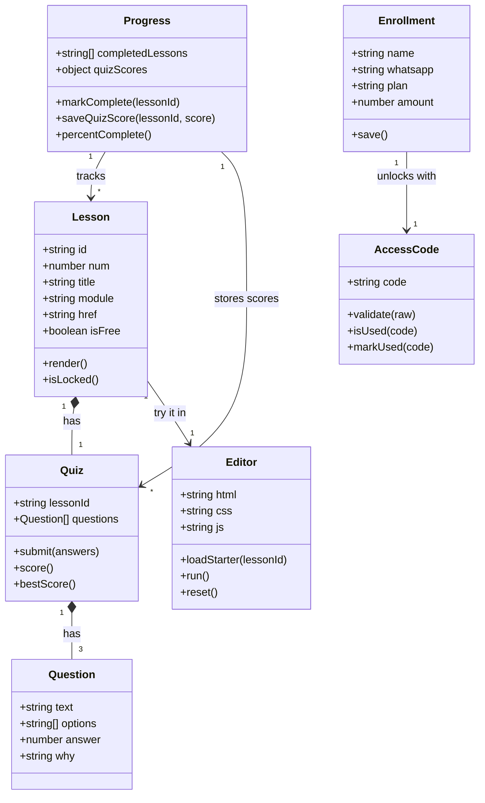
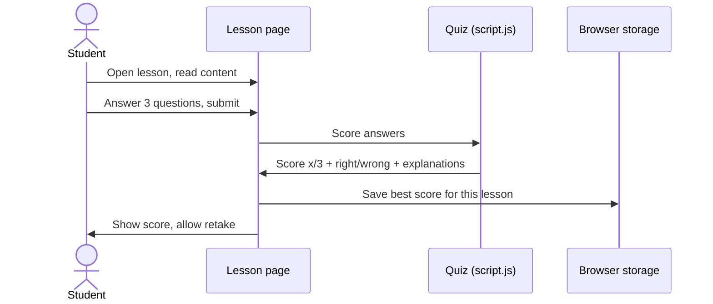
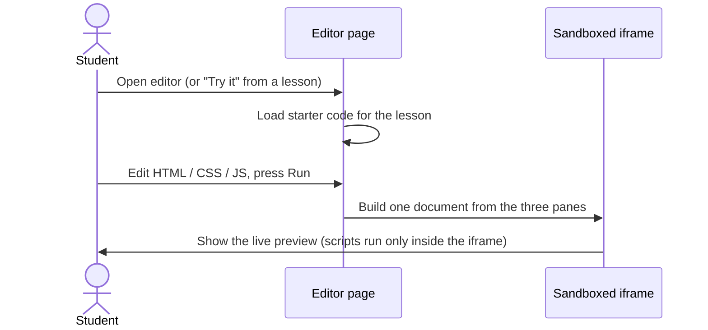

# Software Requirements Specification (SRS) — WebDev Lab
## Version 3.0 — 15 November 2026 (Loop 3, Week 3)

**Project:** WebDev Lab — Learn HTML, CSS & JavaScript by doing
**Author:** Muhammad Usman (Usman Kalera), BS Artificial Intelligence, Superior University Lahore
**Method:** Spiral Model — this SRS covers Loop 3 (Weeks 5–6) and will be updated every loop
**Status:** Draft for review

### Version history
| Version | Date | Loop | Change |
|---|---|---|---|
| 1.0 | 15 Nov 2026 | Loop 1 | First version: sales page, free lessons, waitlist |
| 2.0 | 15 Nov 2026 | Loop 2 | Enrollment + payment flow, access codes, student dashboard |
| 3.0 | 15 Nov 2026 | Loop 3 | Full course (18 lessons + 5 projects), quizzes, live code editor |

---

## 1. Introduction

### 1.1 Purpose
This document describes the requirements for WebDev Lab, an interactive website
that teaches HTML, CSS and JavaScript through hands-on practice, and earns money
through paid enrollments (Batch system, JazzCash/Easypaisa/Nayapay payments).

### 1.2 Scope
Version 3.0 adds the complete course content: the remaining 15 lessons
(HTML 4–5, CSS 1–5, JavaScript 1–8) and 5 guided mini projects, a quiz on
every lesson with instant scoring, and a live code editor with sandboxed
preview. Certificates and search are built in Loop 4 (see the project plan).

### 1.3 Intended audience
Students in Pakistan (school, college and university) who want to learn web
development in English with practical examples. No prior experience is assumed.

### 1.4 Definitions
- **Visitor:** anyone who opens the site without enrolling.
- **Student:** a person who paid and received an access code.
- **Admin:** Muhammad Usman — verifies payments and issues access codes.
- **Access code:** a one-time code (e.g. `WEB-1001`) that unlocks the full course.
- **Batch:** a group of students starting together (Batch 1: 1 December 2026, 20 seats).
- **Quiz:** 3 multiple-choice questions at the end of a lesson, scored instantly.
- **Editor:** the live code editor page — HTML, CSS and JavaScript tabs with a sandboxed preview.

---

## 2. Overall description

### 2.1 Product perspective
A static website (HTML + CSS + JavaScript, no server backend) hosted free on
GitHub Pages. Progress, quiz scores and access are saved in the visitor's
browser (localStorage). Payments are made outside the site
(JazzCash/Easypaisa/Nayapay) and verified manually by the Admin on WhatsApp.
Access codes are a fixed list in the site's code; one-time use is tracked in
the browser, and the Admin's own sheet is the real record of which code
belongs to which student.

### 2.2 User classes
| User | What they do |
|---|---|
| Visitor | Reads free lessons, views the course and price, joins the waitlist, enrolls |
| Student | Unlocks the course with an access code, reads lessons, takes quizzes, uses the editor, builds the 5 projects, downloads the certificate |
| Admin | Verifies payments, issues access codes, manages batches |

### 2.3 Operating environment
Modern browsers (Chrome, Edge, Firefox) on mobile and desktop. No login, no
app install, no account needed for free lessons.

### 2.4 Constraints
- Hosting must be free (GitHub Pages).
- No payment gateway in v3 — manual verification only.
- No user accounts or database in v3.
- All pages must work on a phone (most students use phones).
- Payment numbers on the site must be exactly correct (a wrong number means lost money).
- User code in the editor must run ONLY inside a sandboxed iframe — never in the main page.

### 2.5 Assumptions
- Students have WhatsApp (for payment proof and support).
- The Admin checks every payment screenshot in the payment app before issuing any access code.
- One access code belongs to one student; sharing a code can block access.

---

## 3. Functional requirements

| ID | Requirement | Priority | Status in v3.0 |
|---|---|---|---|
| FR-01 | The home page shows the course, roadmap, price, batch date and seats | Must | Done (Loop 1) |
| FR-02 | 3 HTML lessons are free and open to every visitor | Must | Done (Loop 1) |
| FR-03 | The full lesson list (23 items) is visible; unpaid lessons show a lock | Must | Done (Loop 1) |
| FR-04 | A waitlist form collects name + WhatsApp number and confirms submission | Must | Done (Loop 1) |
| FR-05 | The enroll flow shows JazzCash/Easypaisa/Nayapay payment instructions and the exact amount | Must | Done (Loop 2) |
| FR-06 | A student can enter an access code to unlock the full course | Must | Done (Loop 2) |
| FR-07 | A student dashboard shows progress, unlocked lessons and certificate status | Must | Done (Loop 2) |
| FR-08 | Every lesson has a quiz with instant score and explanation | Must | **Done (Loop 3)** |
| FR-09 | A live code editor (HTML/CSS/JS tabs) shows instant preview in a sandboxed iframe | Must | **Done (Loop 3)** |
| FR-10 | On finishing the course, a student can download a PDF certificate with their name | Must | Planned (Loop 4) |
| FR-11 | The site has a dark/light mode toggle, saved in the browser | Should | Done (Loop 1) |
| FR-12 | Lessons can be searched by name | Should | Planned (Loop 4) |
| FR-13 | Students can contact support through a WhatsApp button | Should | Done (Loop 1) |
| FR-14 | The site shows real testimonials (added after Batch 1) | Should | Planned (Loop 4) |
| FR-15 | All 23 items have real pages: 18 lessons + 5 guided projects | Must | **Done (Loop 3)** |
| FR-16 | Locked lessons (4+) show a lock box to visitors who have not unlocked | Must | **Done (Loop 3)** |

## 4. Non-functional requirements

| ID | Requirement | Target |
|---|---|---|
| NFR-01 | Page load time | Under 2 seconds on normal mobile internet |
| NFR-02 | Responsive design | Usable at 390 px (phone) and 1280 px (desktop); editor tabs stack on phones |
| NFR-03 | Browser support | Chrome, Edge, Firefox (latest versions) |
| NFR-04 | Editor safety | User code runs only inside a sandboxed iframe (`sandbox="allow-scripts"`, no `allow-same-origin`); never `eval()` in the main page |
| NFR-05 | Usability | A new visitor reaches Lesson 1 in under 30 seconds; enrollment takes under 2 minutes |
| NFR-06 | Reliability | No broken links; every page returns 200 |
| NFR-07 | Payment clarity | Payment number and amount are correct and unmistakable |
| NFR-08 | Access-code safety | A wrong or already-used code shows a clear error; a valid code unlocks immediately |
| NFR-09 | Quiz fairness | Every quiz answer is clearly correct from its own lesson's content |

---

## 5. Use cases

Diagram: `use-case-diagram.svg` (same folder, from SRS v1.0 — still valid).

| ID | Use case | Actor | Main flow | Status in v3.0 |
|---|---|---|---|---|
| UC-01 | View free lessons | Visitor | Opens a free lesson, reads it, tries the example | Done |
| UC-02 | Join waitlist | Visitor | Fills name + WhatsApp, submits, sees confirmation | Done |
| UC-03 | Enroll and pay | Visitor | Fills enroll form, sees payment instructions, pays, sends screenshot on WhatsApp | Done |
| UC-04 | Verify payment | Admin | Checks the payment in the payment app | Done (manual) |
| UC-05 | Issue access code | Admin | Sends a unique code to the student on WhatsApp | Done (manual) |
| UC-06 | Enter access code | Student | Enters the code once; full course unlocks | Done |
| UC-07 | Take quiz | Student | Answers 3 questions, sees instant score + explanations | **Done** |
| UC-08 | Use code editor | Student | Writes HTML/CSS/JS, sees live preview in the sandboxed iframe | **Done** |
| UC-09 | Track progress | Student | Sees completed lessons, quiz scores and progress bar | Done |
| UC-10 | Download certificate | Student | Finishes the course, downloads PDF certificate | Planned (Loop 4) |
| UC-11 | Build a mini project | Student | Follows the guided steps, checks the build checklist, marks complete | **Done** |

---

## 6. Class diagram (Loop 3)

---

## 7. Sequence diagrams (Loop 3 flows)

### 7.1 Taking a quiz

### 7.2 Using the live editor

---

## 8. Data (v3 — browser only)

| Data | Stored where | Notes |
|---|---|---|
| Waitlist entries | Browser localStorage (+ WhatsApp message) | Name + WhatsApp number |
| Enrollment | Browser localStorage | Name, WhatsApp, email, plan, amount, date |
| Access codes | `script.js` list (WEB-1001..WEB-1020) + Admin's sheet | One code per student; sheet is the real record |
| Used codes | Browser localStorage | Per-device only — Admin's sheet is the authority |
| Lesson progress | Browser localStorage | Which lessons/projects are complete |
| Quiz scores | Browser localStorage (`webdevlab-quiz-scores`) | Best score per lesson (x/3) |
| Project checklists | Browser localStorage (with progress) | Which build steps are checked |
| Payment proof | WhatsApp chat | Screenshot checked in the payment app |

No personal data is sent to any server by this website in v3.

---

## 9. Future scope (after v3.0)

- Loop 4: PDF certificates, lesson search, testimonials, polish, UAT, marketing (TikTok/IG reels, WhatsApp, free demo class)
- Later: user accounts and automatic payment verification (payment gateway)
- Video lessons and a student community group; referral discounts

---

*End of SRS v3.0 — to be reviewed after Loop 3 and updated in Loop 4.*
